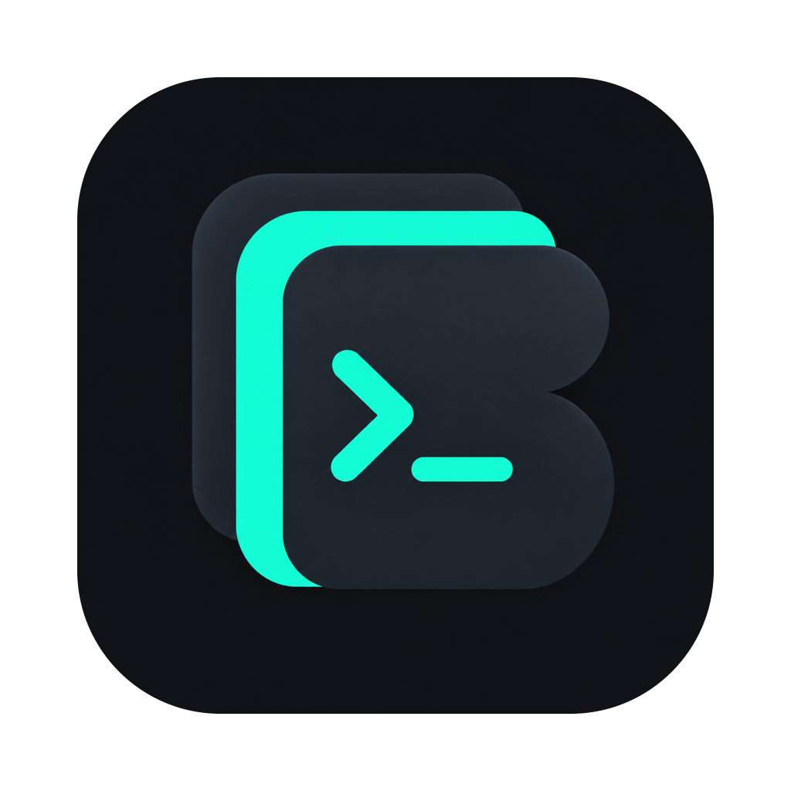
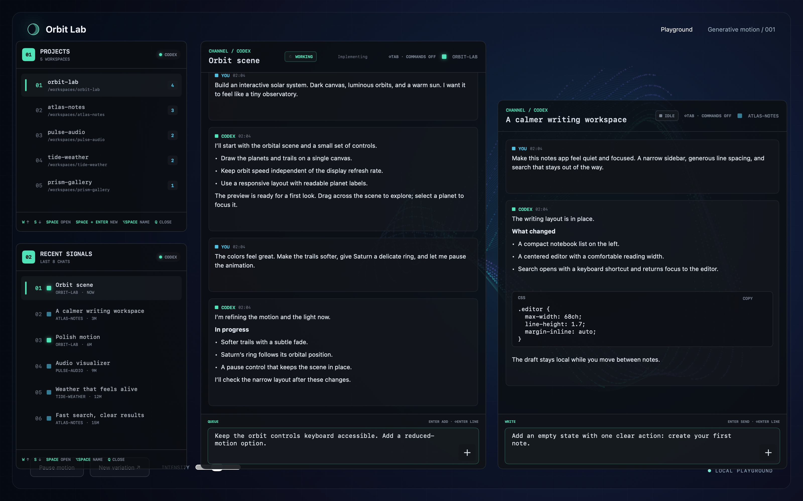

<p align="center">
  
</p>

<h1 align="center">Bavbav</h1>

<p align="center"><strong>A native macOS workspace for Codex.</strong><br />Parallel conversations. Queued instructions. Keyboard navigation.</p>

<p align="center">macOS 14+ · SwiftUI + AppKit</p>

<p align="center">
  <a href="https://github.com/denizybd/bavbav/releases">Downloads</a> ·
  <a href="#build-from-source">Build</a> ·
  <a href="docs/GUIDE.md">User guide</a> ·
  <a href="docs/WORKSPACE.md">Workspace</a>
</p>



<sub>Actual native interface with fictional projects and demo conversations.</sub>

Bavbav brings your installed Codex runtime into independent macOS windows. Keep several projects in view, queue follow-up instructions while an agent works, and move between conversations without losing your draft or reading position.

## What you can do

- **Work across conversations.** Keep several native chat windows beside your editor or preview.
- **Queue and steer.** Reorder waiting instructions or send one into an active turn.
- **Stay on the keyboard.** Jump between projects, chats, models, and your journal.
- **Keep work in sight.** Adjust background transparency while text stays readable.
- **Use native tools.** Read rich Markdown and formulas, attach files, and inspect command activity.

[See the queue and transparency demos →](docs/GUIDE.md#queue-reorder-steer)

## One app, optional Workspace

Bavbav is the main application. **Bavbav Workspace** adds the private collaboration module inside the same app, with project snapshots, chat, and paired P2P synchronization.

| Build | Included |
| --- | --- |
| Public Bavbav | Codex conversations, queues, journal, and Companion. Builds from this repository alone. |
| Authorized Workspace build | Everything above plus the private Workspace module, opened with `⌘7`. Requires access to its separate sources. |

The private module is maintained separately. Its engine, runtime, pairing data, and personalized distribution packages are not part of this public repository or public download. [Architecture and build instructions →](docs/WORKSPACE.md)

## Build from source

Requires **macOS 14+**, a **Swift 6 toolchain**, Git, and an installed, authenticated Codex runtime. Swift dependencies are downloaded during the first build.

```sh
git clone https://github.com/denizybd/bavbav.git
cd bavbav
BAVBAV_STAGE_ONLY=1 zsh scripts/build-app.sh
```

Configure a stable local signing identity using the [signing guide](docs/LOCAL-SIGNING.md). For an explicit development build without one:

```sh
BAVBAV_ALLOW_ADHOC_SIGNING=1 BAVBAV_STAGE_ONLY=1 zsh scripts/build-app.sh
```

The script builds and checks a separate app candidate and prints its path. It does not replace a running installation. Installation and launch steps are in the [user guide](docs/GUIDE.md#build-and-launch).

Public preview downloads are local development builds, **not Apple-notarized releases**. Their release notes identify the tested architecture and build scope.

> Bavbav currently runs coding turns with full filesystem/network access and no per-command approval cards. Use trusted projects and instructions. Model requests use your Codex account; this is not an offline language model.

## Keyboard essentials

| Shortcut | Action |
| --- | --- |
| `⌘1` / `⌘2` | Projects / recent chats |
| `⌘3` / `⌘4` | Standalone chat / model settings |
| `⌘5` / `⌘6` | Journal / Companion |
| `⌘7` | Workspace, in authorized builds |
| `Q` outside text editing | Close a chat view while its active turn continues |
| `⇧Tab` | Show or hide tool activity |

[Full shortcut guide](docs/GUIDE.md#keyboard-cheat-sheet) · [Companion](docs/COMPANION.md) · [Architecture](docs/GUIDE.md#under-the-hood)

## Development

```sh
swift build --build-system native
swift run --build-system native BavbavChecks
BAVBAV_CODEX_BIN="$PWD/.build/debug/BavbavFakeCodex" .build/debug/BavbavChecks --protocol-fixture
```

[GitHub Actions](https://github.com/denizybd/bavbav/actions) checks the public source build and core/protocol behavior. The packaged-app script additionally exercises native fixture checks. Real account, voice, screen sharing, and two-device P2P acceptance are separate checks.

[Report an issue](https://github.com/denizybd/bavbav/issues) with your macOS version, commit, and reproduction steps. Keep private conversations and credentials out of reports.

Bavbav is an independent project, not affiliated with OpenAI. No project-wide license has been selected; third-party notices remain with their dependencies.
