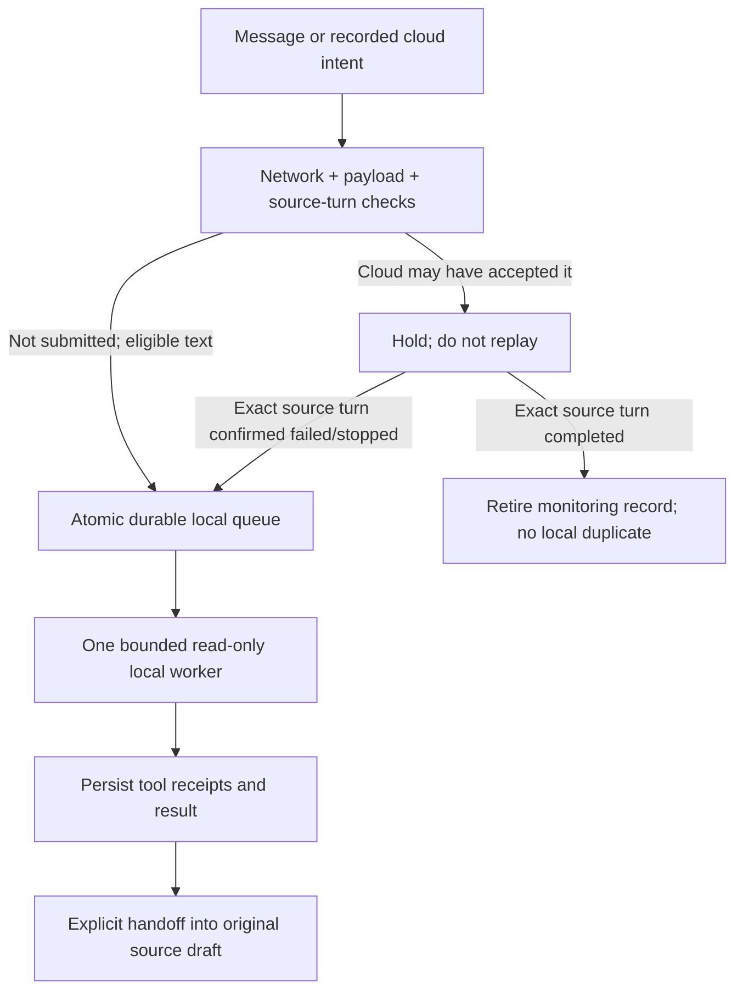

# Local AI / Offline Handoff — native extension 0.1.0

This integration targets the Bavbav 0.16.0 (74) unified release candidate. The extension remains version 0.1.0; build, branch publication, installation, and installed-user acceptance are separate steps.

Open **Windows → Yerel AI · çevrimdışı görev devri**, or press **⌘9** while Bavbav
is active. This is a native Bavbav extension, not a ChatGPT plugin, browser tab,
or a second application. Its controls follow Bavbav's dark appearance. The
normal model selector still controls the Codex conversation; local tasks use
the single explicitly pinned local model instead.

This first release is intentionally **read-only**: it can inspect local UTF-8
source/text files, search them, produce analysis, and record proposed changes.
It cannot execute a shell command, edit source files, run tests, browse, use
account credentials, or claim that a proposal has been applied. It is not the
same cloud model continuing its private reasoning offline.

## What happens when the network disappears

The native host records the source conversation, workspace, objective, a small
visible-text checkpoint, execution limits, and a unique request identity.
Private reasoning is not transferred. Recognizable API tokens are redacted;
this is an additional safeguard, not proof that arbitrary text is secret-free.



- **New, unsent text:** when the extension and automatic routing are enabled and
  macOS reports no usable network path, an eligible message can go straight to
  the local queue. Accepted local messages and their result appear beside the
  existing source conversation, clearly labeled LOCAL/Qwen3. They do not replace
  its cloud history or create a second cloud request.
  In version 0.1.0 this automatic signal is specifically `NWPath.status ==
  .unsatisfied`; it is not a general provider-health or offline-internet probe.
- **Already sent or uncertain:** a transport timeout is not evidence that a
  cloud operation stopped. Cloud intent is checkpointed before submission, then
  bound to the exact server turn when acknowledged. Unknown acceptance remains
  held; an unrelated turn or a later reply on the same thread cannot resolve it.
  Only matching server evidence can retire completed work or make confirmed
  failed/stopped work eligible for local continuation. Without an identifiable
  server turn, the task is not guessed, replayed, or advertised as completed.
- **Unsupported payload:** images, documents/other composer attachments, Plan,
  and active Goal semantics are not silently downgraded. Automatic local routing
  rejects them with a visible explanation and keeps the original draft. The
  manual panel is for text/read-only work, not a substitute implementation of
  Codex's full tool capabilities.
- **Network comes back:** completed local results are not automatically sent to
  the cloud. Select **Kaynak sohbete aktar** to put the structured report in the
  original conversation's empty composer. It cannot overwrite a current draft
  or attachments, target a different active chat, or send without Enter.

Connectivity detection is deliberately not a claim that every cloud provider
is reachable. An available Wi-Fi route, a VPN, DNS trouble, or a provider outage
does not by itself prove that a possibly accepted cloud request can be replayed.
The manual panel remains available for explicitly selected read-only work.

## Local in the conversation-account window

The account window offers three separate providers: **Deniz**, **Emir**, and
**Local · this Mac**. The cloud choices retain their existing account/pairing
requirements; Local remains available without private Workspace account RPCs.
Local always uses this Mac's pinned model and hardware, not a remote peer's
model. It does not consume either cloud account's quota.

Local continuation is an explicit, separate task with bounded visible context;
provider selection does not send a message, transfer credentials, copy hidden
reasoning, or turn the local model into the same cloud session. Its messages and
results are not sent through `accountSend`/`accountReply` or to the other device.
If Local is unavailable or disabled, the draft stays intact; there is no silent
fallback to Deniz or Emir. A prepared return report still requires explicit
acceptance and never sends itself.

## Using the panel

1. Keep **Yerel eklenti** enabled. **İnternet yokken uygun yeni mesajları devret**
   controls automatic routing; manual local work does not require that toggle.
2. The host locates its Bavbav checkout from the packaged `LocalAI/host.json`, a
   saved selection, or the development source path. **Repo seç** can select the
   checkout if it moved. A repository cannot be changed during setup or active
   work; the previous owned runtime is stopped before switching.
3. Setup verifies or clones the exact existing local assets into the checkout.
   If they are missing, the automatic setup action can retrieve the pinned
   public assets. A missing connection is reported; it does not create an
   infinite retry or choose another model. Initial provisioning must complete
   before reliable offline use. See [runtime installation and provenance](LOCAL-AI-RUNTIME.md).
4. The selected source and workspace appear above the text field. **Çalışma
   klasörü** explicitly changes the read-only workspace for a manual task. Write
   a bounded objective and choose **Yerelde çalıştır**.
5. The task list shows queued/running/completed/paused/held states separately.
   Progress entries are persisted evidence, not hidden reasoning. **Durdur**
   cancels the task. **Devam et** explicitly resumes eligible paused/failed/waiting
   work using its saved receipts; it does not pretend an interrupted step ran.

Closing the native window is presentation-only: an accepted local task continues
in Bavbav's background. Disabling the extension pauses active work, cancels setup,
waits for cleanup, and stops only the verified owned runtime. Re-enabling does
not automatically replay interrupted work. A full app quit checkpoints/pauses
active work; this release does not install a separate always-running launch
daemon or promise execution while Bavbav/the Mac is off.

## Integrity, memory, and tool boundaries

- **Exact model:** `huihui_ai/qwen3-abliterated:14b-v2`, Qwen3 14.8B/Q4_K_M. The
  lock pins original and wrapper manifests, every model layer, Ollama 0.40.6,
  dependent runtime libraries, sizes, hashes, and license provenance. No silent
  model substitution or cloud fallback is permitted.
- **Owned runtime:** `http://127.0.0.1:11439`, isolated `HOME` and model store under
  the checkout. The user's separate global Ollama port 11434, existing models,
  and running jobs are not stopped or reconfigured. No API key, browser cookies,
  ChatGPT account session, or inherited proxy credentials are used.
- **One worker:** one parallel task/model, 4096-token request context, bounded
  input/output and step/time budgets. The host defaults to eight steps and three
  minutes per task. The worker keeps only a small evidence ledger and releases
  its own model after success, failure, or cancellation. Starting the server is
  not the same as loading the model. A 14B model still needs substantial unified
  memory; this does not make a 16 GB Mac unlimited or justify stopping another
  application's loaded model.
- **Read-only filesystem:** paths stay inside the explicitly selected workspace.
  Traversal, symlinks, hidden/credential paths, binary files, runtime/dependency
  trees, and unsafe special files are rejected. Reads/searches have byte, file,
  enumeration, match, and line limits. Truncated or skipped coverage is reported;
  a bounded search is not represented as a complete repository audit.
- **Proposals are data:** `propose_change` records source SHA256, proposed text,
  and `applied: false`. It does not modify the source. Only actual tool receipts
  establish what was read; a model's prose is not execution/test evidence.

This community model has reduced refusal filtering. Pinning it proves which
bytes ran, not that every answer is correct or safe. Native host and tool
boundaries apply independently of the model's instructions or generated output.

## Data and extension layout

`Sources/BavbavOffline` is a reusable Swift package target with no AppKit UI or
Codex authentication dependency. It contains the task types, atomic repository,
single-worker coordinator, bounded file tools, and isolated loopback transport.
`OfflineAIService` adapts source conversations, network state, setup/lifecycle,
and explicit composer handoff. `OfflineAIWindowController` presents it natively.

The native descriptor is `Resources/LocalAI/extension-manifest.json`, version
0.1.0. The host app's release number is separate. This file is not an OpenAI
plugin manifest and does not register tools in ChatGPT/Codex.

- Tasks: `~/Library/Application Support/Bavbav/OfflineAI/Tasks/tasks.json`, private
  user-only files, atomic replacement and an exclusive repository lease.
- Runtime/weights: `<checkout>/Runtime/LocalAI/`, private and **ignored by Git**.
  They physically reside inside the checkout but are not public Git objects.
- App bundle: only the small extension descriptor, model lock, installer code,
  and generated checkout pointer are copied to `Contents/Resources/LocalAI/`.
  The 9 GB model and runtime are never recursively copied into the app/release.

Task snapshots are local, not a separately encrypted vault. Avoid putting secrets
in prompts or ordinary source files; redaction is not a general secret detector.
Deleting a view does not delete a durable task or silently delete its evidence.

## Verification and honest acceptance

The following levels are distinct; this document is not itself a test receipt.

```sh
# Small installer fixtures: no real model copy, daemon, network or inference.
python3 scripts/local-ai-setup.py --repo "$PWD" check

# Core fake-worker/HTTP/filesystem/state-machine fixtures.
.build/release/BavbavOfflineChecks

# Actual hidden native host/store flow with local FakeCodex + fake worker only.
BAVBAV_OFFLINE_CHECK=1 BAVBAV_CODEX_BIN="$PWD/.build/release/BavbavFakeCodex" \
  .build/release/Bavbav --offline-render /absolute/path/offline.png \
  --offline-ui-report /absolute/path/offline-ui.json

# Account-window Local routing, with fake workers/RPC only; no cloud account.
BAVBAV_SHARED_LOCAL_CHECK=1 BAVBAV_CODEX_BIN="$PWD/.build/release/BavbavFakeCodex" \
  .build/release/Bavbav
```

The canonical package script runs these fixture levels before writing its
validated receipt. The hidden check covers source/draft isolation, one local
message/result pair, no cloud turn RPC, unsupported-payload preservation, held
ambiguity, safe composer handoff, background close, and disable/cancellation.
It does not prove physical key presses or real model performance.

Real inference is a separate opt-in diagnostic. After completing setup/start,
the command below loads the pinned model and consumes local RAM/GPU. It attempts
to read a unique synthetic nonce file through the real tool and reports success
only if the answer, unchanged source hash, and durable handoff report validate.
It fails closed on an incomplete/model-invalid result. It does not contact the
cloud account or read a production chat:

```sh
python3 scripts/local-ai-setup.py --repo "$PWD" setup
python3 scripts/local-ai-setup.py --repo "$PWD" start
.build/release/BavbavOfflineChecks --live --offline-report /absolute/path/offline-live.json
python3 scripts/local-ai-setup.py --repo "$PWD" status
```

Record actual live output and post-task loaded-model state separately from the
fixture report. A successful build, fake answer, or installed 9 GB file is not a
completed real handoff test. Before reporting user acceptance, also exercise the
installed version's ⌘9 panel and an offline eligible source conversation, verify
that the original remains intact, and confirm that returning to the cloud only
fills the intended empty composer until the user sends it.
